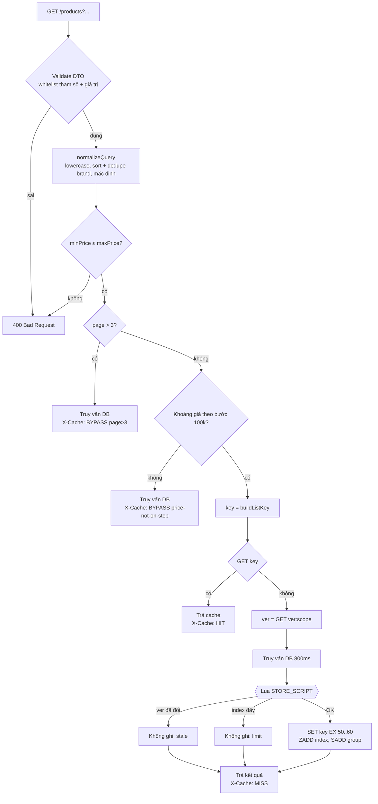
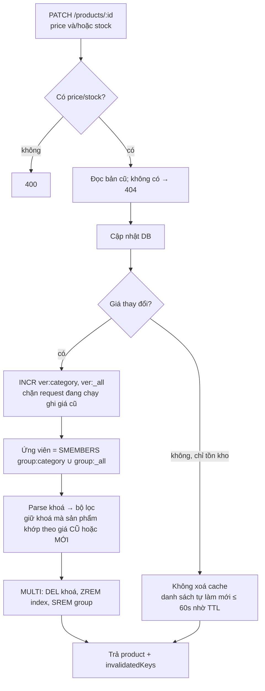

# Bài 7 – Tầng bộ nhớ đệm cho trang danh mục có bộ lọc

NestJS + Redis (`ioredis`), đo tải bằng `autocannon`.

## Bối cảnh

Trang danh mục ShopFast cho lọc theo danh mục, khoảng giá, thương hiệu, sắp xếp theo 3 tiêu chí, và có phân trang. Truy vấn tổng hợp nặng nên mỗi lần tải mất **800ms**. Giờ cao điểm có **3.000 lượt xem/phút** (≈ 50 req/s).

| #  | Yêu cầu nghiệp vụ |
|----|-------------------|
| R1 | Lần gọi sau với cùng bộ lọc phải trả về **< 20ms**. |
| R2 | Sản phẩm đổi **giá** hoặc **tồn kho** thì mọi kết quả lọc chứa sản phẩm đó phải được làm mới. |
| R3 | Chỉ cache **3 trang đầu** của mỗi tổ hợp lọc. Từ trang 4 trở đi truy vấn thẳng DB. |
| R4 | Tồn kho được trễ tối đa **60s**. Giá phải **chính xác tuyệt đối**. |
| T1 | **Bẫy:** cùng nội dung lọc nhưng thứ tự tham số khác nhau phải ra **cùng một khoá**. |
| T2 | **Bẫy:** kẻ tấn công gửi hàng nghìn tổ hợp vô nghĩa để làm phình cache. |

---

# A. Báo cáo phân tích và thiết kế

## A1. Phân tích bài toán (I/O)

### Đầu vào ảnh hưởng tới kết quả

`GET /products?category=&brand=&minPrice=&maxPrice=&sort=&page=`

| Tham số | Kiểu | Miền giá trị hợp lệ | Mặc định | Chuẩn hoá |
|---------|------|---------------------|----------|-----------|
| `category` | `enum` (string) | `phone`, `laptop`, `tablet`, `audio`, `watch` | không lọc → `_all` | trim + lowercase |
| `brand` | `string[]` | ⊂ {`apple`, `samsung`, `xiaomi`, `sony`, `asus`, `dell`, `lenovo`, `oppo`}, tối đa 5 | không lọc → `_all` | nhận cả `a,b` lẫn `brand=a&brand=b`; lowercase, **bỏ trùng, sắp xếp** |
| `minPrice` | `int` (VND) | 0 … 100.000.000 | `0` | thiếu ≡ 0 |
| `maxPrice` | `int` (VND) | 0 … 100.000.000, ≥ `minPrice` | không giới hạn → `max` | |
| `sort` | `enum` | `price_asc`, `price_desc`, `newest` | `newest` | lowercase |
| `page` | `int` | 1 … 500 | `1` | `01` ≡ `1` |

- **Không** ảnh hưởng kết quả, nên không đưa vào khoá: thứ tự tham số, chữ hoa/thường, khoảng trắng, thương hiệu lặp lại.
- **Bị từ chối:** mọi tham số khác (`utm_source`, `foo`…), để rác không lọt vào khoá.
- `pageSize` cố định 20, không phải tham số.

### Dữ liệu nguồn và tính chất thay đổi

| Trường | Tần suất đổi | Yêu cầu độ tươi | Ảnh hưởng tới kết quả lọc |
|--------|--------------|-----------------|---------------------------|
| `price` | Thấp (khuyến mãi) | **Tuyệt đối** | Lọc theo khoảng giá, sắp xếp, hiển thị |
| `stock` | **Rất cao** (mỗi đơn hàng) | Trễ ≤ 60s | Chỉ hiển thị |
| `category`, `brand` | Gần như không đổi | | Lọc |

### Cấu trúc dữ liệu đầu ra được cache

Mỗi khoá là một **string JSON** của một trang kết quả:

```json
{
  "page": 1, "pageSize": 20, "total": 10, "totalPages": 1,
  "items": [
    { "id": 94, "name": "apple phone 94", "category": "phone", "brand": "apple",
      "price": 2280000, "stock": 36, "createdAt": "2026-01-04T22:00:00.000Z" }
  ],
  "generatedAt": "2026-10-21T13:10:00.000Z"
}
```

Phản hồi HTTP có thêm header `X-Cache: HIT | MISS | BYPASS`, `X-Cache-Key` và `X-Cache-Note` để kiểm thử.

## A2. Đề xuất giải pháp

### 1. Sinh khoá từ tập tham số

Chuẩn hoá query thành một `CatalogFilter` duy nhất, rồi ghép các trường theo **thứ tự cố định**:

```
shopfast:catalog:list:cat={category|_all}:brand={b1,b2..|_all}:price={min}-{max|max}:sort={sort}:page={n}
```

Ví dụ: cả ba query dưới đây đều cho ra `shopfast:catalog:list:cat=phone:brand=apple,samsung:price=0-max:sort=price_asc:page=1`

```
?category=phone&brand=samsung,apple&sort=price_asc
?sort=PRICE_ASC&brand=Apple&brand=samsung&category=Phone&minPrice=0
?brand=apple,samsung,apple&sort=price_asc&category=phone
```

Khoá để dạng đọc được (không băm), vì hai lý do: kiểm chứng trực tiếp bằng `redis-cli --scan`, và có thể **parse ngược** ra bộ lọc khi cần vô hiệu hoá. Độ dài khoá luôn bị chặn vì mọi trường đều đã được whitelist.

### 2. Thời gian sống theo loại dữ liệu

| Dữ liệu | Chiến lược |
|---------|------------|
| Tồn kho | **TTL 50–60s**, ngẫu nhiên để tránh hết hạn đồng loạt. Không vô hiệu hoá khi tồn kho đổi, vì tồn kho đổi theo từng đơn hàng; xoá cache mỗi lần như vậy sẽ làm hit-rate về 0. Tồn kho trong cache luôn trễ ≤ 60s (R4). |
| Giá | **Vô hiệu hoá chủ động ngay** khi giá đổi. Không phụ thuộc TTL. |
| Trang ≥ 4 | Không cache. |

### 3. Nhóm khoá để vô hiệu hoá hàng loạt

| Redis key | Kiểu | Vai trò |
|-----------|------|---------|
| `shopfast:catalog:meta:group:{category\|_all}` | SET | Danh sách khoá thuộc nhóm danh mục |
| `shopfast:catalog:meta:ver:{category\|_all}` | STRING (counter) | Version của nhóm, tăng mỗi khi có giá trong nhóm đổi |
| `shopfast:catalog:meta:index` | ZSET (score = thời điểm hết hạn) | Đếm và giới hạn tổng số khoá đang sống |

Khi giá sản phẩm `p` (danh mục `c`) đổi từ `old` sang `new`:

1. Ứng viên = `SMEMBERS group:c ∪ group:_all`. Sản phẩm chỉ có thể xuất hiện trong danh sách lọc đúng danh mục của nó, hoặc danh sách không lọc danh mục.
2. Parse từng khoá thành bộ lọc. **Chỉ xoá** khoá mà `p` khớp bộ lọc theo **giá cũ** hoặc **giá mới**:
   - khớp theo giá cũ: `p` đang nằm trong kết quả, hoặc được tính vào `total`;
   - khớp theo giá mới: `p` **có thể lọt vào** kết quả hoặc làm đổi thứ tự sắp xếp.

   Chỉ xoá "các danh sách đang chứa `p`" là **chưa đủ**: hạ giá từ 2,28tr xuống 1,5tr thì `p` phải xuất hiện trong danh sách "phone ≤ 2tr", nơi trước đó không có nó.
3. Danh sách khác danh mục, khác thương hiệu, hoặc có khoảng giá không chứa cả giá cũ lẫn giá mới: **giữ nguyên**.

**Chống ghi đè giá cũ (race condition).** Request A bắt đầu truy vấn DB (800ms) với giá cũ. Giữa chừng giá đổi và cache bị xoá. Nếu không chặn, A ghi kết quả mang giá cũ vào cache và kết quả sai đó sống thêm 60s. Giải pháp: A đọc `ver:{scope}` trước khi truy vấn. Script Lua chỉ ghi cache nếu `ver` vẫn y nguyên. Phía cập nhật giá thì **tăng version trước, rồi mới xoá khoá**.

### 4. Chống phình cache (T2)

| Lớp | Cơ chế | Đoạn mã |
|-----|--------|---------|
| 1 | Whitelist tham số: tham số lạ → `400` | `forbidNonWhitelisted` trong [`main.ts`](src/main.ts) |
| 2 | Whitelist giá trị: `category`/`sort` thuộc enum, `brand` thuộc danh sách và tối đa 5, giá/trang là số nguyên trong giới hạn | [`catalog-query.dto.ts`](src/catalog/dto/catalog-query.dto.ts) |
| 3 | Chuẩn hoá: biến thể của cùng một bộ lọc không sinh khoá mới | `normalizeQuery`, `buildListKey` trong [`catalog-filter.ts`](src/catalog/catalog-filter.ts) |
| 4 | Khoảng giá phải theo bước 100.000 (khớp thanh trượt UI) mới được cache. Giá lẻ vẫn trả kết quả nhưng `BYPASS` | `isCacheablePriceRange` |
| 5 | Trang ≥ 4 không cache | `MAX_CACHED_PAGE` trong [`catalog.service.ts`](src/catalog/catalog.service.ts) |
| 6 | **Trần tổng số khoá** `MAX_CACHE_KEYS` (mặc định 2000, đặt qua env `CATALOG_MAX_KEYS`). Script Lua dọn các khoá đã hết hạn khỏi ZSET, đếm, và từ chối sinh khoá mới khi đầy. Thao tác nguyên tử nên nhiều request song song cũng không vượt trần | `STORE_SCRIPT` trong [`catalog-cache.service.ts`](src/catalog/catalog-cache.service.ts) |

## A3. Thiết kế các bước

### Luồng một request danh mục



Dạng gạch đầu dòng:

1. Validate tham số và giá trị (whitelist). Sai → `400`.
2. Chuẩn hoá thành `CatalogFilter` + `page`. Kiểm tra `minPrice ≤ maxPrice`.
3. `page > 3` → truy vấn DB, trả `BYPASS`, không sinh khoá.
4. Khoảng giá không theo bước 100k → truy vấn DB, trả `BYPASS`.
5. Sinh khoá. Có trong cache → trả `HIT`.
6. Miss: đọc version của nhóm → truy vấn DB → chạy Lua ghi cache. Script **bỏ qua** việc ghi nếu version đã đổi hoặc đã chạm trần → trả `MISS`.

### Luồng khi một sản phẩm được cập nhật



1. Validate body, đọc bản cũ (không có → `404`), cập nhật DB.
2. Chỉ đổi tồn kho: không xoá gì. Kết quả lọc tự làm mới trong ≤ 60s.
3. Giá đổi:
   1. `INCR` version của nhóm `category` và `_all`.
   2. Lấy ứng viên từ hai SET nhóm.
   3. Parse từng khoá, giữ lại khoá mà sản phẩm khớp bộ lọc theo giá cũ hoặc giá mới.
   4. Xoá trong một `MULTI`.
4. Trả về `invalidatedKeys` để kiểm chứng.

---

# B. Triển khai

```
src/
├── main.ts                         ValidationPipe whitelist + forbidNonWhitelisted
├── redis.module.ts
├── catalog/
│   ├── catalog.constants.ts        enum, PAGE_SIZE, MAX_CACHED_PAGE, bước giá, TTL, MAX_CACHE_KEYS
│   ├── dto/catalog-query.dto.ts    validate + chuẩn hoá kiểu (bẫy T1, T2)
│   ├── dto/update-product.dto.ts
│   ├── catalog-filter.ts           normalizeQuery, buildListKey, parseListKey, matchesFilter
│   ├── catalog-cache.service.ts    Lua ghi cache (version + trần khoá), vô hiệu hoá theo nhóm
│   ├── catalog.service.ts          luồng đọc danh mục, luồng cập nhật sản phẩm
│   ├── catalog.controller.ts       GET /products, PATCH /products/:id, header X-Cache
│   └── product.repository.ts       DB giả lập: 300 sản phẩm, truy vấn danh mục 800ms
└── debug/debug.controller.ts       GET/DELETE /debug/cache
scripts/load-test.mjs               autocannon: latency, attack
```

## Cách chạy

```bash
cd bai7
npm install
npm run start:dev                   # http://localhost:3000, Redis mặc định redis://localhost:6380

# terminal khác
npm run loadtest:latency            # MISS / HIT / trang 4
npm run loadtest:attack             # tấn công làm phình cache (nên chạy app với CATALOG_MAX_KEYS=100)
```

Khởi động với trần thấp để dễ quan sát (PowerShell): `$env:CATALOG_MAX_KEYS=100; npm run start:dev`

Endpoint hỗ trợ kiểm thử: `GET /debug/cache` (danh sách khoá + TTL + số truy vấn DB), `DELETE /debug/cache` (xoá toàn bộ cache danh mục).

## Kết quả kiểm chứng

### 1. Lần gọi thứ hai < 20ms (`npm run loadtest:latency`)

`GET /products?category=phone&brand=samsung,apple&sort=price_asc`

| Lần | Thời gian | X-Cache |
|-----|----------:|---------|
| 1 | 816,5 ms | MISS |
| 2 | **4,7 ms** | HIT |

autocannon:

| Kịch bản | Tổng request | Req/s | Avg | p50 | p99 | Max |
|----------|-------------:|------:|----:|----:|----:|----:|
| HIT, 100 req/s × 10s (gấp đôi giờ cao điểm) | 1.000 | 100 | **3,27 ms** | 2 ms | 13 ms | 17 ms |
| HIT, stress 50 connection × 5s | 18.658 | 3.732 | 12,9 ms | 12 ms | 28 ms | 45 ms |
| Trang 4 BYPASS, 10 connection × 5s | 60 | 12 | 808 ms | 806 ms | 818 ms | 818 ms |

Ở tải thực tế (≤ 100 req/s), mọi request HIT đều < 20ms. Kịch bản stress đẩy tới khoảng 3.700 req/s (gấp ~75 lần giờ cao điểm). Lúc đó p99 tăng do request xếp hàng trên một tiến trình Node, không phải do Redis. Trang 4 luôn khoảng 800ms vì đi thẳng DB, và **không sinh khoá nào**.

### 2. Thứ tự tham số khác nhau → cùng một khoá

```bash
GET /products?category=phone&brand=samsung,apple&sort=price_asc                    → MISS
GET /products?sort=PRICE_ASC&brand=Apple&brand=samsung&category=Phone&minPrice=0   → HIT
GET /products?brand=apple,samsung,apple&sort=price_asc&category=phone              → HIT

$ docker exec shopfast-redis-1 redis-cli --scan --pattern "shopfast:catalog:list:*"
shopfast:catalog:list:cat=phone:brand=apple,samsung:price=0-max:sort=price_asc:page=1
```

### 3. Cập nhật giá làm mới đúng các kết quả lọc liên quan

Cache có sẵn 6 danh sách. Cập nhật SP 94 (phone, apple) từ 2.280.000 xuống **1.500.000**:

| Khoá | SP 94 khớp (giá cũ / giá mới) | Kết quả |
|------|-------------------------------|---------|
| `cat=phone:brand=apple,samsung:price=0-max:sort=price_asc` | ✔ / ✔ | **Xoá** |
| `cat=phone:brand=_all:price=0-2000000:sort=price_asc` | ✘ / ✔ (mới lọt vào) | **Xoá** |
| `cat=_all:brand=_all:price=0-max:sort=price_asc` | ✔ / ✔ | **Xoá** |
| `cat=phone:brand=_all:price=20000000-35000000:sort=newest` | ✘ / ✘ | Giữ |
| `cat=laptop:brand=_all:price=0-max:sort=newest` | khác danh mục | Giữ |
| `cat=_all:brand=sony:price=0-1000000:sort=newest` | khác thương hiệu | Giữ |

Sau đó:

- `GET ?category=phone&brand=samsung,apple&sort=price_asc` → `MISS`, SP đầu `94: 1500000`.
- `GET ?category=phone&maxPrice=2000000&sort=price_asc` → `total` từ 0 lên **1** (SP 94).

### 4. Cập nhật tồn kho: cho phép trễ ≤ 60s

`PATCH /products/157 {"stock":0}` → `invalidatedKeys: []`. Danh sách vẫn `HIT` với `stock = 103`, `TTL` còn 52s. Sau khi hết hạn, danh sách lấy lại `stock = 0`.

### 5. Chống ghi đè giá cũ

Gửi `GET ?category=phone&sort=price_asc` (MISS, 800ms). Sau 300ms gửi `PATCH /products/94 {"price":1400000}`. Request GET trả `X-Cache-Note: not-stored:stale` và **không có khoá nào được ghi**. Request kế tiếp `MISS` và trả đúng giá 1.400.000.

### 6. Tấn công làm phình cache (`CATALOG_MAX_KEYS=100`, `npm run loadtest:attack`)

Gửi 1.000 request: 600 tổ hợp hợp lệ khác nhau cộng 400 request rác.

| Kết quả | Số request |
|---------|-----------:|
| `400` (tham số lạ, danh mục không tồn tại) | 200 |
| `200 BYPASS price-not-on-step` | 100 |
| `200 BYPASS page>3` | 100 |
| `200 MISS` (đã ghi cache) | 100 |
| `200 MISS not-stored:limit` | 500 |
| **Số khoá trong Redis** | **100 = trần** |

## Test case chính (Postman)

Base URL `http://localhost:3000`. Xem header `X-Cache` và `X-Cache-Key` ở tab **Headers** của response.

| TC | Request | Kết quả mong đợi | Kết quả |
|----|---------|------------------|---------|
| 1 | `DELETE /debug/cache` → `GET /products?category=phone&brand=samsung,apple&sort=price_asc` hai lần | Lần 1 `MISS` khoảng 800ms, lần 2 `HIT` < 20ms (xem Time của Postman) | ✅ |
| 2 | `GET /products?sort=PRICE_ASC&brand=Apple&brand=samsung&category=Phone` | `HIT`, cùng `X-Cache-Key` với TC 1; `--scan` chỉ ra 1 khoá | ✅ |
| 3 | `GET /products?sort=price_asc&page=4` | `BYPASS page>3`; `--scan --pattern "*page=4*"` rỗng | ✅ |
| 4 | Gọi các GET ở mục kết quả 3 → `PATCH /products/94` `{"price":1500000}` | `invalidatedKeys` gồm đúng 3 khoá; GET lại thấy giá mới | ✅ |
| 5 | `PATCH /products/157` `{"stock":0}` | `invalidatedKeys: []`, danh sách vẫn `HIT`, `TTL` ≤ 60 | ✅ |
| 6 | `GET /products?category=phone&utm=x` | `400 property utm should not exist` | ✅ |
| 7 | `GET /products?category=abc` / `?brand=apple,samsung,sony,asus,dell,oppo` | `400` | ✅ |
| 8 | `GET /products?category=phone&minPrice=123457` | `200`, `BYPASS price-not-on-step` | ✅ |
| 9 | `GET /products?minPrice=5000000&maxPrice=1000000` | `400 minPrice must be less than or equal to maxPrice` | ✅ |
| 10 | `PATCH /products/94` `{}` / `PATCH /products/9999` `{"price":1}` | `400` / `404` | ✅ |

Lệnh Redis:

```bash
docker exec shopfast-redis-1 redis-cli --scan --pattern "shopfast:catalog:list:*"
docker exec shopfast-redis-1 redis-cli TTL "shopfast:catalog:list:cat=phone:brand=apple,samsung:price=0-max:sort=price_asc:page=1"
docker exec shopfast-redis-1 redis-cli ZCARD shopfast:catalog:meta:index
docker exec shopfast-redis-1 redis-cli SMEMBERS shopfast:catalog:meta:group:phone
```

## Giới hạn đã biết

- Danh sách không lọc danh mục (`_all`) bị xoá khi **bất kỳ** sản phẩm nào đổi giá mà khớp bộ lọc. Chấp nhận được vì giá đổi ít. Nếu cần có thể thêm nhóm theo thương hiệu.
- Version guard tính theo cả nhóm danh mục, nên một lần đổi giá có thể khiến vài request đang chạy (cùng nhóm) không ghi cache. Hậu quả chỉ là thêm một lần miss, không sai dữ liệu.
- Chưa chống dồn dập khi một khoá danh mục hết hạn (đã xử lý ở bài 6, có thể ghép khoá phân tán vào nhánh MISS).
- Script Lua dùng nhiều khoá. Với Redis Cluster cần dùng hash tag `{catalog}` để các khoá nằm cùng slot.
- Request rác bị chặn khỏi cache nhưng vẫn tốn DB (nhánh `BYPASS`). Ở production nên thêm rate limit theo IP.
