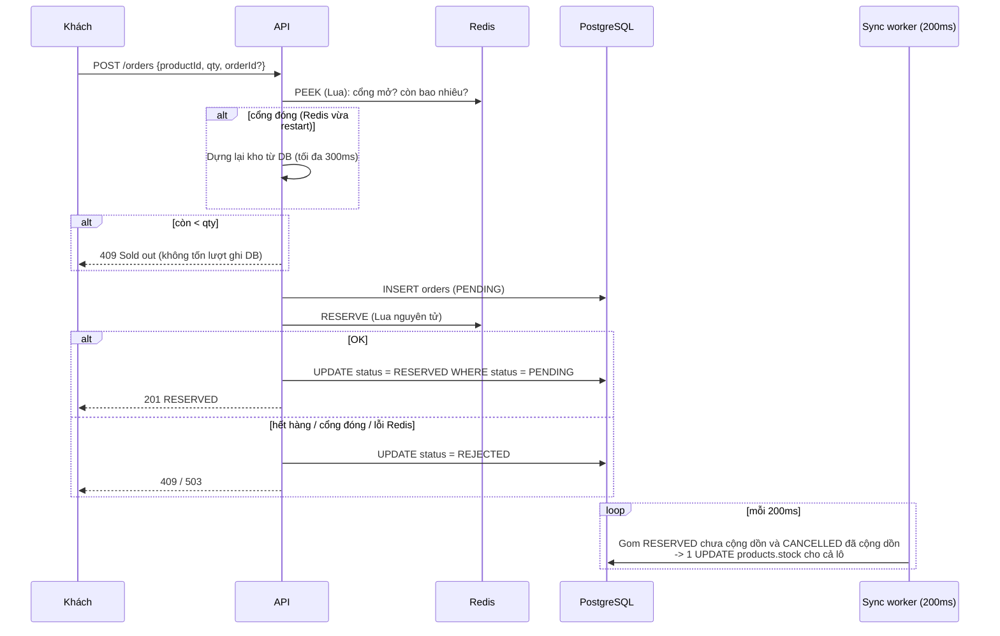

# Bài 8 – Chọn chiến lược ghi cho tồn kho thời gian thực

NestJS + Redis (`ioredis`, Lua) + PostgreSQL (`pg`). Docker Compose dựng Redis và Postgres riêng cho bài này.

## Bối cảnh

Flash sale: **400 lượt trừ kho/giây** trên **cùng một sản phẩm**. Cơ sở dữ liệu quan hệ chỉ chịu khoảng **150 lượt ghi/giây trên cùng một dòng**.

| #  | Quy tắc nghiệp vụ |
|----|-------------------|
| R1 | Tuyệt đối **không bán vượt** tồn kho thực tế. |
| R2 | Khách thấy phản hồi đặt hàng trong **≤ 500ms**. |
| R3 | Kết thúc chiến dịch, tồn kho trong DB **khớp tuyệt đối** với thực tế đã bán. |
| T1 | **Bẫy:** Redis có thể khởi động lại giữa chiến dịch. |
| T2 | **Bẫy:** đơn bị huỷ giữa chừng phải hoàn số lượng vào tồn kho. |

---

# A. Phân tích và đề xuất đa giải pháp

## A1. Đầu vào và đầu ra

**Đầu vào**

| Nguồn | Dữ liệu | Kiểu | Ghi chú |
|-------|---------|------|---------|
| Khách đặt hàng | `productId` | int | Một sản phẩm "nóng" nhận 400 lượt/s |
| | `qty` | int, 1–5 | |
| | `orderId` | UUID, tuỳ chọn | Khoá idempotent, cho phép client gửi lại an toàn khi mất phản hồi |
| Khách / hệ thống huỷ đơn | `orderId` | UUID | Có thể đến bất kỳ lúc nào, có thể gửi lặp |
| Vận hành | Tồn kho đầu chiến dịch | int ≥ 0 | |
| Sự cố | Redis khởi động lại | sự kiện | Có thể mất dữ liệu, hoặc **nạp lại dữ liệu cũ** từ AOF/RDB |

**Đầu ra**

| Đầu ra | Nội dung |
|--------|----------|
| Phản hồi đặt hàng (≤ 500ms) | `201 {orderId, status: RESERVED, remaining}` · `409 Sold out` · `503 Retry` |
| Phản hồi huỷ đơn | `200 {status: CANCELLED, restock: restocked\|already\|deferred}` · `409` · `404` |
| Dữ liệu bền vững | Sổ cái `orders` (mỗi đơn một dòng) và `products.stock` |
| Báo cáo đối chiếu cuối chiến dịch | Tồn kho ban đầu, đã bán, đã huỷ, tồn kho DB, tồn kho Redis, kết quả các phép kiểm tra |

**Bất biến cần giữ**

- Mọi thời điểm: `Σ qty(RESERVED) ≤ tồn kho ban đầu` (R1).
- Kết thúc chiến dịch: `products.stock = tồn kho ban đầu − Σ qty(RESERVED)` (R3).

## A2. Ràng buộc khó thoả mãn nhất

Định lượng nhanh:

- Ghi thẳng DB: `ρ = λ/μ = 400/150 ≈ 2,67 > 1`, tức hàng đợi tăng **250 request mỗi giây**.
- Thời gian chờ vượt 500ms khi hàng đợi chỉ cần 75 request, tức sau khoảng **0,3 giây**.
- Sau 10 giây, hàng đợi khoảng 2.500 request, thời gian chờ khoảng **16,7 giây**.

Muốn đạt R2 thì bộ đếm tồn kho buộc phải rời khỏi dòng DB, chuyển sang một kho nhanh trong bộ nhớ (Redis). Nhưng Redis là bộ nhớ dễ mất, và có thể restart (T1).

**R1 (không bán vượt) là ràng buộc khó nhất.** R2 có thể giải bằng Redis, và R3 có thể giải bằng đối soát sau. Còn R1 phải đúng **tại từng thời điểm, với từng đơn**, kể cả khi kho nhanh vừa mất dữ liệu hoặc nạp lại số liệu cũ. Một lần bán vượt là không sửa lại được: khách đã nhận xác nhận cho món hàng không tồn tại. Mọi quyết định thiết kế bên dưới đều xoay quanh việc giữ R1 trong lúc Redis gặp sự cố.

## A3. Các giải pháp

### (a) Ghi thẳng cơ sở dữ liệu

```sql
UPDATE products SET stock = stock - $qty WHERE id = $id AND stock >= $qty;  -- 0 dòng = hết hàng
```

Điều kiện `stock >= qty` nằm trong cùng câu lệnh và có khoá dòng của DB, nên nguyên tử: **không bán vượt**. Nhưng mọi request đều tranh cùng một dòng, nên thông lượng bị chặn ở 150/s.

### (b) Ghi đồng thời cả cache và DB (write-through)

Mỗi request trừ trên Redis (để trả lời nhanh và chặn khi hết hàng) **và** `UPDATE` DB đồng bộ trước khi trả lời. Request vẫn phải chờ DB ghi xong, nên thông lượng vẫn bị chặn ở 150/s. Thêm vào đó là rủi ro **ghi kép không nhất quán**: Redis đã trừ nhưng DB lỗi thì phải bù trừ.

### (c) Ghi vào cache trước, đồng bộ xuống DB theo lô (write-behind)

Redis trừ kho bằng script Lua nguyên tử rồi trả lời ngay. Worker định kỳ (ví dụ 200ms) đẩy tổng lượng đã trừ xuống DB. Nhanh, nhưng **dữ liệu chưa đồng bộ chỉ nằm trong Redis**:

- Redis restart thì mất các lượt trừ chưa đồng bộ.
- Tệ hơn, Redis nạp lại snapshot cũ có tồn kho **cao hơn thực tế**, dẫn tới **bán vượt**, và DB cũng không bao giờ biết các đơn đã mất.

### (d) Đề xuất: (c) gia cố bằng sổ cái bền vững (Redis gate + DB ledger + batch sync)

Tách hai vai trò mà (c) đang gộp chung vào Redis:

| Vai trò | Đặt ở đâu | Lý do |
|---------|-----------|-------|
| **Quyết định** còn hàng hay không (nguyên tử, nhanh) | Redis, script Lua | Khoảng 0,1ms, không có giới hạn 150/s |
| **Ghi nhận** đơn đã bán (bền vững) | DB, bảng `orders`: mỗi đơn **một dòng INSERT riêng** | Không tranh chấp dòng nóng. INSERT các dòng khác nhau chịu được hàng nghìn lượt/s |
| Cập nhật dòng `products.stock` | DB, cộng dồn theo lô mỗi 200ms | 400 lượt/s gom lại còn khoảng **5 lượt ghi/s** trên dòng nóng |

Khách chỉ nhận xác nhận **sau khi** đơn đã nằm trong sổ cái DB. Vì vậy Redis mất dữ liệu cũng không làm mất đơn nào đã xác nhận, và luôn dựng lại được số tồn kho chính xác từ DB.

---

# B. So sánh và lựa chọn

Số liệu của (a), (b), (c) là ước tính theo đề (λ = 400/s, μ = 150/s trên một dòng, Redis khoảng 100k thao tác/s). Số liệu của (d) là **đo thực tế** ở mục C5.

| Tiêu chí | (a) Ghi thẳng DB | (b) Write-through | (c) Write-behind thuần | **(d) Gate + Ledger + Batch** |
|----------|------------------|-------------------|------------------------|-------------------------------|
| **Độ trễ cảm nhận của khách** | Khoảng 7ms khi rảnh. Ở 400/s, hàng đợi tăng 250/s: vượt 500ms sau ~0,3s, khoảng 16,7s sau 10s ❌ | Như (a) cộng thêm một vòng Redis ❌ | Khoảng 1–5ms ✅ | **p50 7,5ms, p99 41–66ms**, max 215ms (lúc Redis restart) ✅ |
| **Chịu 400 lượt ghi/s** | Không: tối đa 150/s trên dòng nóng, đáp ứng 37,5% ❌ | Không: DB vẫn là cổ chai 150/s ❌ | Có: Redis dư sức. Dòng DB chỉ khoảng 5 lượt/s ✅ | Có: Redis gate + INSERT các dòng riêng + **48 lượt UPDATE dòng nóng cho khoảng 3.500 thay đổi** (~4,8/s) ✅ |
| **Rủi ro mất dữ liệu khi Redis restart** | Không có (không dùng Redis) ✅ | Thấp: DB là nguồn thật, dựng lại Redis từ DB ✅ | **Cao.** Mất lượt trừ trong cửa sổ đồng bộ (200ms ≈ 80 đơn) cộng cửa sổ AOF (≤ 1s ≈ 400 đơn). Snapshot cũ có tồn kho cao hơn thực tế, dẫn tới **bán vượt** và DB lệch ❌ | **0 đơn đã xác nhận bị mất.** Cổng tự đóng theo `run_id`, dựng lại từ DB trong khoảng 15ms. Cái giá là khoảng 0,7s trả `503` (khoảng 270–340 request, khách bấm lại) ✅ |
| **Không bán vượt (R1)** | Có: `WHERE stock >= qty` nguyên tử ✅ | Có, nếu trừ trên Redis bằng Lua; nhưng phải xử lý ghi kép ⚠️ | Có khi Redis ổn định; **không** khi Redis restart ❌ | Có: Lua nguyên tử, và **không bao giờ mở cổng với số liệu chưa được dựng lại từ DB** ✅ |
| **DB khớp tuyệt đối (R3)** | Có ✅ | Có, nếu bù trừ đúng khi ghi kép lỗi ⚠️ | Không đảm bảo ❌ | Có: `products.stock = ban đầu − Σ RESERVED`, kiểm chứng bằng endpoint đối chiếu ✅ |
| **Độ phức tạp cài đặt và vận hành** | Thấp: một câu SQL ✅ | Trung bình: bù trừ ghi kép, hai nguồn dữ liệu ⚠️ | Trung bình: worker, cấu hình AOF ⚠️ | **Cao**: 4 script Lua, sổ cái, worker, quy trình dựng lại, đối chiếu. Cần giám sát độ trễ đồng bộ ❌ |

### Lựa chọn: (d) Redis gate + DB ledger + batch sync

- **(a) và (b) loại** vì vi phạm R2 về mặt toán học: tải 400/s vượt năng lực 150/s của dòng nóng, nên hàng đợi tăng không giới hạn.
- **(c) loại** vì vi phạm R1, ràng buộc khó nhất. Khi Redis restart và nạp lại snapshot cũ, Redis tin rằng còn nhiều hàng hơn thực tế và tiếp tục bán. Không có cách nào phát hiện, vì dữ liệu đúng chỉ nằm trong chính Redis đã mất.
- **(d) giữ R1 bằng ba lớp:**
  1. **Nguyên tử khi trừ:** kiểm tra và trừ trong cùng một script Lua. Redis chạy script tuần tự, nên không request nào chen được vào giữa (mục C2).
  2. **Không tin Redis sau sự cố:** khoá `ready` lưu `run_id` của Redis lúc dựng kho. Mọi script so sánh nó với `run_id` hiện tại; lệch nhau thì từ chối. Như vậy dữ liệu cũ được AOF/RDB nạp lại **không bao giờ được dùng để bán**.
  3. **Nguồn sự thật bền vững:** đơn chỉ được xác nhận khi đã nằm trong sổ cái DB. Kho Redis luôn dựng lại được chính xác bằng `products.stock − Σ RESERVED chưa cộng dồn + Σ CANCELLED đã cộng dồn`.

  Mọi tình huống mơ hồ (timeout, tiến trình chết) đều nghiêng về **bán thiếu** (an toàn, khắc phục được) chứ không bao giờ **bán vượt**.

---

# C. Thiết kế và triển khai

## C1. Mô hình dữ liệu

**PostgreSQL**

```sql
products(id, name, initial_stock, stock CHECK (stock >= 0))
orders(id UUID PK, product_id, qty, status, stock_applied BOOLEAN, created_at, updated_at)
--   status: PENDING -> RESERVED | REJECTED,  RESERVED -> CANCELLED
--   stock_applied: lượng trừ của đơn đã được cộng dồn vào products.stock hay chưa
```

**Redis** (hash tag `{id}` để chạy được trên Redis Cluster)

| Khoá | Kiểu | Ý nghĩa |
|------|------|---------|
| `inv:{id}:stock` | string (int) | Số còn bán được |
| `inv:{id}:ready` | string | `run_id` của Redis lúc dựng kho. Đây là "cổng" |
| `inv:{id}:released` | SET | Các `orderId` đã hoàn kho. Giúp huỷ idempotent |
| `inv:{id}:rebuild-lock` | string, `PX` 10s | Khoá phân tán cho quá trình dựng lại |

## C2. Trừ kho nguyên tử

Cách làm **sai** (hai lệnh rời nhau):

```
A: GET stock -> 1        B: GET stock -> 1
A: DECR stock -> 0       B: DECR stock -> -1   ← bán vượt
```

Cách làm **đúng**, [`redis-inventory.store.ts`](src/inventory/redis-inventory.store.ts):

```lua
if redis.call('GET', KEYS[2]) ~= run_id() then return -2 end        -- cổng đóng: Redis đã restart
local qty = tonumber(ARGV[1])
local stock = tonumber(redis.call('GET', KEYS[1]) or '0')
if stock < qty then return -1 end                                     -- hết hàng
return redis.call('DECRBY', KEYS[1], qty)                             -- còn lại, luôn >= 0
```

Redis thực thi mỗi script **trọn vẹn và tuần tự** trên một luồng. Ba bước kiểm tra cổng, kiểm tra tồn kho và trừ diễn ra như một thao tác duy nhất.

## C3. Luồng đặt hàng



1. `PEEK`: cổng đóng thì dựng lại kho (C5), tối đa 300ms để giữ ngân sách 500ms. Hết hàng thì trả `409` ngay, không ghi DB.
2. `INSERT orders` trạng thái `PENDING`: ghi ý định đặt hàng vào sổ cái **trước** khi trừ kho. `orderId` trùng thì trả lại trạng thái cũ (idempotent).
3. `RESERVE` bằng Lua nguyên tử.
4. Thành công: `UPDATE ... SET status='RESERVED' WHERE status='PENDING'`, rồi mới trả `201`. Có điều kiện `WHERE` nên nếu quá trình dựng lại đã ép đơn sang `REJECTED` thì không xác nhận cho khách.
5. Worker mỗi 200ms chạy **một câu SQL** ([`order.repository.ts`](src/inventory/order.repository.ts), `syncBatch`): khoá các đơn cần cộng dồn (`FOR UPDATE SKIP LOCKED`), lật cờ `stock_applied`, rồi `UPDATE products SET stock = stock + Σdelta`. Worker chỉ làm việc trong DB nên **không phụ thuộc Redis**.

## C4. Huỷ đơn và hoàn kho (bẫy T2)

```mermaid
sequenceDiagram
    participant K as Khách
    participant A as API
    participant D as PostgreSQL
    participant R as Redis
    K->>A: POST /orders/:id/cancel
    A->>D: BEGIN; SELECT ... FOR UPDATE<br/>RESERVED -> CANCELLED; COMMIT
    A->>R: RELEASE (Lua): SADD released orderId<br/>chỉ INCRBY nếu SADD = 1
    alt Redis lỗi / cổng đóng
        A->>A: Thử lại nền 0,5s, 1s, 2s, 4s (an toàn vì idempotent)
    end
    A-->>K: 200 CANCELLED {restock}
    Note over D: Worker: CANCELLED và stock_applied<br/>-> products.stock += qty
```

- **Ghi DB trước.** Trạng thái `CANCELLED` bền vững là nguồn sự thật; Redis chỉ là bản sao để bán tiếp.
- **Idempotent.** Huỷ hai lần, hoặc retry sau timeout, chỉ hoàn kho một lần nhờ `SADD` vào `released`.
- **Phía DB.** Đơn đã được cộng dồn (`stock_applied = true`) thì worker cộng trả lại `products.stock`. Chưa cộng dồn thì bỏ qua, coi như chưa từng trừ.
- **Chỉ huỷ được đơn `RESERVED`.** Đơn `REJECTED` hay `PENDING` trả `409`.
- **Không xung đột với worker.** Worker dùng `SKIP LOCKED`; lệnh huỷ dùng `FOR UPDATE` trên cùng dòng.

## C5. Khôi phục khi Redis khởi động lại (bẫy T1)

**Phát hiện.** Mỗi lần khởi động, Redis có một `run_id` mới. Mọi script Lua so sánh `GET inv:{id}:ready` với `run_id` hiện tại (đọc bằng `INFO server` ngay trong script). Sau khi restart:

- **Mất sạch dữ liệu** thì không còn khoá `ready`, cổng đóng.
- **Nạp lại dữ liệu cũ** từ AOF/RDB thì `ready` chứa `run_id` cũ, **cũng đóng**.

Đây là điểm (c) thuần không làm được: Redis nạp lại `stock` cũ thì trông vẫn "bình thường".

**Dựng lại** ([`inventory-recovery.service.ts`](src/inventory/inventory-recovery.service.ts)). Request đầu tiên gặp cổng đóng sẽ kích hoạt quy trình (các request cùng lúc dùng chung một lần dựng):

1. Giành `rebuild-lock` (`SET NX PX 10000`). Instance khác đang dựng thì chờ cổng mở.
2. **Chờ các đơn `PENDING` tạo trước thời điểm này** kết thúc, tối đa 3s. Đơn nào đã trừ trên Redis cũ sẽ kịp ghi `RESERVED` vào DB trước khi ta tính số. Quá hạn mà vẫn `PENDING` (tiến trình xử lý đã chết, khách chưa nhận xác nhận) thì ép sang `REJECTED`.
3. Trong một transaction `REPEATABLE READ`, tính:

   ```
   available = products.stock − Σ(RESERVED ∧ ¬stock_applied) + Σ(CANCELLED ∧ stock_applied)
   ```

   Đồng thời lấy danh sách đơn `CANCELLED`.
4. Script `INIT`: `SET stock = available`, nạp các đơn đã huỷ vào `released` (để lệnh huỷ đến muộn không hoàn kho lần nữa), `SET ready = run_id`. Cổng mở.

Trong lúc dựng lại, request trả `503` sau tối đa khoảng 300ms. Khách bấm lại; nếu gửi lại cùng `orderId` thì không tạo đơn trùng.

**Phân tích các điểm có thể hỏng**

| Hỏng tại | Hệ quả | Bán vượt? |
|----------|--------|-----------|
| Sau `INSERT PENDING`, trước `RESERVE` | Lua chưa chạy; đơn bị `REJECTED` hoặc ép `REJECTED` khi dựng lại | Không |
| Sau `RESERVE` OK, Redis restart trước khi ghi `RESERVED` | Bước 2 chờ đơn ghi `RESERVED` rồi mới tính số, nên đơn được tính | Không |
| Sau `RESERVE` OK, **tiến trình API chết** | Đơn kẹt `PENDING`, ép `REJECTED`; Redis (nếu không restart) đã trừ, dẫn tới **bán thiếu** `qty` | Không |
| Redis nạp lại AOF/RDB cũ | `run_id` lệch, cổng đóng, dựng lại từ DB | Không |
| Huỷ: DB đã `CANCELLED`, Redis lỗi | Thử lại nền. Nếu Redis restart, bước 3 đã tính đơn này và `released` chặn hoàn kho lần hai | Không |
| Lệnh Redis timeout (200ms) | Đơn `REJECTED`. Redis có thể đã trừ, dẫn tới bán thiếu. ioredis **không tự gửi lại** lệnh đang dở (`autoResendUnfulfilledCommands: false`), tránh trừ hai lần | Không |

## C6. Cấu trúc mã nguồn

```
docker-compose.yml                  Redis 7 (AOF bật, cổng 6391) + Postgres 16 (cổng 5441)
src/
├── redis.module.ts                 ioredis: không xếp hàng khi mất kết nối, timeout 200ms, không gửi lại
├── database/database.module.ts     Pool pg + tạo schema + seed 2 sản phẩm
└── inventory/
    ├── redis-inventory.store.ts    4 script Lua: PEEK, RESERVE, RELEASE, INIT (+ fencing theo run_id)
    ├── order.repository.ts         Sổ cái, syncBatch (1 câu SQL), snapshot dựng lại, thống kê
    ├── order.service.ts            Luồng đặt hàng và huỷ đơn
    ├── inventory-recovery.service.ts  Dựng lại kho khi Redis restart
    ├── stock-sync.worker.ts        Worker cộng dồn theo lô mỗi 200ms
    └── inventory.controller.ts     API
scripts/simulate.mjs                Mô phỏng burst / sustained / restart
```

## C7. Cách chạy

```bash
cd bai8
docker compose up -d                # Redis :6391, Postgres :5441
npm install
npm run start:dev                   # http://localhost:3000

# terminal khác
npm run sim:burst                   # 400 lượt đồng thời, tồn kho 100
npm run sim:sustained               # 400 lượt/s trong 10s, tồn kho 3000, ~10% huỷ
npm run sim:restart                 # như trên + docker compose restart redis ở giây thứ 4
```

| Method | Path | Mục đích |
|--------|------|----------|
| `POST` | `/orders` | `{"productId":1,"qty":1,"orderId":"<uuid, tuỳ chọn>"}` |
| `POST` | `/orders/:id/cancel` | Huỷ đơn, hoàn kho |
| `GET` | `/orders/:id` | Xem đơn |
| `GET` | `/inventory/:productId` | Trạng thái Redis (stock, ready, run_id), số liệu DB, thống kê worker |
| `POST` | `/inventory/:productId/reconcile` | Kết thúc chiến dịch: đồng bộ hết rồi đối chiếu |
| `POST` | `/campaigns/:productId/reset` | `{"stock":100}`: mở chiến dịch mới (dùng khi kiểm thử) |

## C8. Kết quả mô phỏng

### 400 lượt trừ kho đồng thời, tồn kho 100 (`npm run sim:burst`)

| Kết quả | Số lượng |
|---------|---------:|
| `201 RESERVED` | **100** |
| `409 Sold out` | 300 |
| Tồn kho DB / Redis | **0 / 0** |
| Độ trễ p50 / p99 | 316 / 338 ms |
| UPDATE dòng `products` | 2 lần cho 100 lượt trừ |

Cả 400 request được bắn **cùng một lúc**, khắc nghiệt hơn 400 lượt rải đều trong 1 giây, nhưng vẫn đúng 100 đơn thành công, tồn kho không âm.

### 400 lượt/s trong 10s, tồn kho 3.000, ~10% huỷ (`npm run sim:sustained`)

| Chỉ số | Giá trị |
|--------|--------:|
| Đơn gửi | 3.998 |
| `201 RESERVED` / `409 Sold out` | 3.337 / 661 |
| Huỷ và hoàn kho | 337 (đều `restocked`) |
| Đã bán ròng | **3.000 = tồn kho ban đầu** |
| Tồn kho DB / Redis | **0 / 0** |
| Độ trễ p50 / p99 / max | **9,9 / 66,4 / 176 ms** |
| Dòng nóng | 3.580 thay đổi → **46 UPDATE** (~4,6 lượt/s so với giới hạn 150/s) |

### Redis khởi động lại ở giây thứ 4 (`npm run sim:restart`)

```
Redis restart lúc +4.0s, mất 0.8s; run_id f6bbd10f -> 815c0e95
503 xuất hiện từ +4.24s đến +4.89s
Rebuilt inventory of product 2: available=1483, stalePendingRejected=0, took 15ms
```

| Chỉ số | Giá trị |
|--------|--------:|
| Đơn gửi | 3.997 |
| `201 RESERVED` / `409` / `503` | 3.315 / 414 / **268** (chỉ trong cửa sổ 0,65s) |
| Huỷ: `restocked` / `deferred` | 308 / 7 (7 đơn hoàn kho trễ, vẫn được tính đúng) |
| Đã bán ròng | **3.000** |
| Tồn kho DB / Redis | **0 / 0** |
| Độ trễ p50 / p99 / max (mọi đơn) | **7,5 / 41,4 / 215,6 ms** |
| Đối chiếu | `noOversell`, `dbStockMatchesSales`, `redisMatchesDb`, `nonNegative`: **tất cả true** |

Redis chạy với AOF nên đã nạp lại dữ liệu cũ sau khi restart, nhưng `run_id` mới làm cổng đóng và kho được dựng lại từ DB. Không đơn nào bị bán vượt hay bị mất.

## C9. Test case chính (Postman)

Trước khi chạy: `POST /campaigns/1/reset` với body `{"stock":2}`.

| TC | Request | Kết quả mong đợi | Kết quả |
|----|---------|------------------|---------|
| 1 | `POST /orders` `{"productId":1,"qty":1,"orderId":"11111111-1111-4111-8111-111111111111"}` | `201 RESERVED, remaining 1` | ✅ |
| 2 | Gửi lại đúng request TC 1 | `duplicate: true`, không trừ thêm | ✅ |
| 3 | `POST /orders` `{"productId":1,"qty":1}` | `201, remaining 0` | ✅ |
| 4 | Gửi tiếp TC 3 | `409 Sold out` | ✅ |
| 5 | `POST /orders/11111111-1111-4111-8111-111111111111/cancel` | `200 CANCELLED, restock: restocked` | ✅ |
| 6 | Huỷ lại lần 2 | `alreadyCancelled: true, restock: already` (không hoàn 2 lần) | ✅ |
| 7 | `POST /orders` `{"productId":1,"qty":1}` | `201`: bán tiếp được món vừa hoàn | ✅ |
| 8 | `POST /inventory/1/reconcile` | `ok: true`, DB = Redis = 0, sold = 2 | ✅ |
| 9 | `docker compose restart redis` → `GET /inventory/1` → `POST /orders` (sau khi reset stock) | `redis.ready: false` → đơn đầu tiên tự dựng lại kho → `201`; `run_id` mới | ✅ |
| 10 | `{"productId":1,"qty":0}` / `{"productId":999,"qty":1}` / huỷ orderId không tồn tại | `400` / `404` / `404` | ✅ |

Lệnh Redis:

```bash
docker exec bai8-redis-1 redis-cli MGET "inv:{1}:stock" "inv:{1}:ready"
docker exec bai8-redis-1 redis-cli INFO server | grep run_id
docker exec bai8-postgres-1 psql -U shopfast -d inventory -c "SELECT status, COUNT(*), SUM(qty) FROM orders WHERE product_id = 2 GROUP BY status"
```

## Giới hạn đã biết

- **Tiến trình API chết** giữa lúc Redis đã trừ và lúc ghi `RESERVED`: dẫn tới bán thiếu `qty` cho tới lần dựng lại kế tiếp. Endpoint đối chiếu sẽ báo `redisMatchesDb: false`; xoá khoá `inv:{id}:ready` là buộc được hệ thống dựng lại.
- **Mỗi đơn tốn 2 lượt ghi DB trên các dòng khác nhau** (INSERT + UPDATE). PostgreSQL chịu được hàng nghìn lượt/s kiểu này, nhưng nếu tải tăng 10–20 lần thì cần gom INSERT theo lô, hoặc dùng hàng đợi bền vững (Kafka/Redis Stream có replica).
- **Redis đơn node.** Có replica thì failover cũng đổi `run_id`, cơ chế dựng lại vẫn đúng.
- **Endpoint `/campaigns/:id/reset` chỉ dùng để kiểm thử.**
