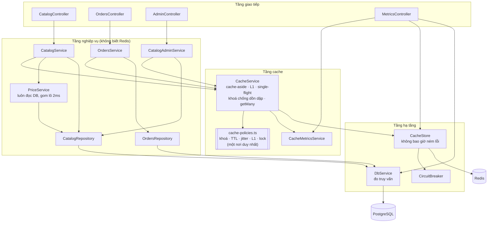
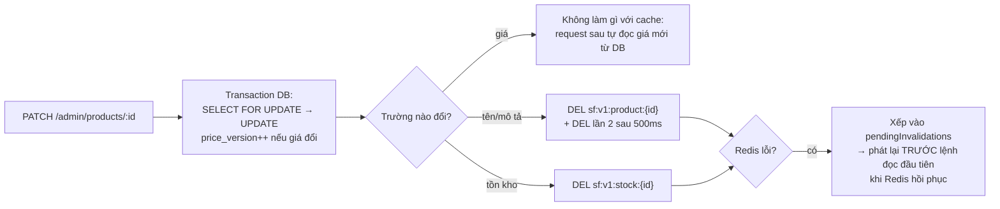
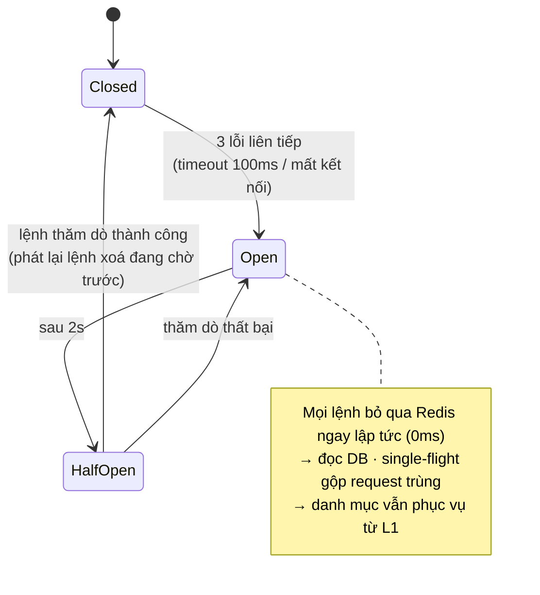

# Bài 9 – Tầng tăng tốc cho toàn bộ ShopFast

NestJS + Redis (`ioredis`) + PostgreSQL (`pg`). Docker Compose dựng Redis và Postgres riêng cho bài này. Dữ liệu mẫu gồm 2.000 sản phẩm, 200k đánh giá, 100k đơn hàng và 300k dòng đơn hàng.

> "Chi phí cơ sở dữ liệu tháng này tăng 60%, mà trang vẫn chậm vào giờ cao điểm. Tôi muốn giảm cả hai, nhưng tuyệt đối không được để khách nhìn thấy giá sai."
> Giám đốc kỹ thuật ShopFast

## Kết quả chính

| Chỉ số | Trước (không cache) | Sau | Thay đổi |
|--------|--------------------:|----:|---------:|
| Truy vấn DB / request | 2,27 | **0,29** | **−87%** |
| Thời gian DB thực thi / request | 18,66 ms | **3,44 ms** | **−82%** |
| Thời gian chờ kết nối DB / request | 44,67 ms | **0,25 ms** | −99% |
| Throughput (50 kết nối) | 1.067 req/s | **2.652 req/s** | **×2,5** |
| Độ trễ p95 | 123,3 ms | **37,9 ms** | **−69%** |
| Tắt Redis giữa tải | | **0 lỗi 5xx** / 67.640 request | |
| Đổi giá liên tục (207 lần) trong khi đọc 44.787 lần, có tắt Redis | | **0 lần thấy giá cũ** | |

---

## 1. Đặc tả: thu hẹp yêu cầu mở

### Diễn giải yêu cầu thành mục tiêu đo được

| # | Mục tiêu | Chỉ số thành công | Loại |
|---|----------|-------------------|------|
| G1 | Giảm chi phí DB | Truy vấn DB / request giảm ≥ 70%; thời gian DB / request giảm ≥ 70% | Tối ưu |
| G2 | Trang nhanh giờ cao điểm | p95 giảm ≥ 50% dưới cùng tải | Tối ưu |
| G3 | **Không bao giờ hiển thị giá sai** | 0 lần đọc thấy giá cũ sau khi đổi giá đã commit, kể cả khi Redis gặp sự cố | **Ràng buộc cứng** |
| G4 | Redis sập không làm sập trang | 0 lỗi 5xx khi Redis tắt; chỉ chậm hơn | Ràng buộc cứng |

G3 và G4 là ràng buộc cứng: không đánh đổi lấy hiệu năng. G1 và G2 là mục tiêu tối ưu trong khuôn khổ G3/G4.

### Phạm vi đã chọn

| Thuộc phạm vi | Lý do ưu tiên |
|---------------|---------------|
| **Trang sản phẩm** (`GET /products/:id`) | ~45% lượt xem. Gồm truy vấn join + tổng hợp đánh giá. Đây cũng là nơi hiển thị giá, gắn trực tiếp với G3 |
| **Top bán chạy theo danh mục** (`GET /categories/:slug/top-sellers`) | Truy vấn đắt nhất (quét 300k dòng đơn hàng). Chiếm **47% thời gian DB** dù chỉ có 20% lượt xem |
| **Danh mục** (`GET /categories`) | Xuất hiện ở mọi trang, đổi vài lần mỗi tháng. Dễ đạt ~100% trúng |
| **Lịch sử đơn của tôi** (`GET /me/orders`) | Đại diện dữ liệu riêng tư. Có rủi ro rò dữ liệu giữa người dùng nếu thiết kế khoá sai |
| **Ghi**: đặt hàng, admin sửa sản phẩm/danh mục | Để kiểm chứng vô hiệu hoá và G3 |

| Ngoài phạm vi | Lý do |
|---------------|-------|
| Tìm kiếm full-text, giỏ hàng, thanh toán | Tìm kiếm cần search engine riêng. Giỏ hàng/thanh toán là luồng ghi, cần tính nhất quán chứ không cần cache |
| CDN, ảnh, tài nguyên tĩnh | Không đi qua DB nên không đóng góp vào chi phí DB |
| Cache HTTP ở trình duyệt/CDN cho trang có giá | Không kiểm soát được việc vô hiệu hoá, mâu thuẫn với G3 |

### Quyết định then chốt: giá không đi qua cache

Mọi chiến lược cache giá đều còn cửa sổ lỗi:

- request đọc giá cũ từ DB rồi ghi đè vào cache *sau* khi đã xoá;
- Redis sập đúng lúc đổi giá nên lệnh xoá thất bại, Redis lên lại vẫn giữ giá cũ;
- network partition giữa một instance và Redis;
- tiến trình chết giữa lúc commit DB và lúc xoá cache.

Vì vậy **giá được tách khỏi mọi bản ghi cache** và luôn đọc từ DB, bằng truy vấn khoá chính `WHERE id = ANY($1)`. Các request đồng thời trong cửa sổ 2ms được **gom lô** thành một truy vấn: 130.332 lượt đọc giá chỉ tốn 3.253 truy vấn, mỗi truy vấn ~6ms. Chi phí này rất nhỏ so với các truy vấn nặng đã được cache. Bù lại, rủi ro giá sai **bằng 0 theo thiết kế**, không phụ thuộc vào việc vô hiệu hoá có thành công hay không.

---

## 2. Kiến trúc

### Sơ đồ module



**Nguyên tắc tách lớp**

| Lớp | Trách nhiệm | Không được biết |
|-----|-------------|-----------------|
| `config/cache-policies.ts` | **Chính sách**: mẫu khoá, TTL, jitter, L1, chống dồn dập, xoá kép, lý do | Redis, nghiệp vụ |
| `cache/CacheService` | Áp dụng chính sách: cache-aside, L1, single-flight, khoá, đo đếm | Lệnh Redis cụ thể, SQL |
| `infrastructure/redis/CacheStore` | **Truy cập Redis**: GET/MGET/SET/DEL/lock, circuit breaker, phát lại lệnh xoá. Không bao giờ ném lỗi | Loại dữ liệu, TTL |
| `catalog/`, `orders/` | **Nghiệp vụ**: chỉ gọi `cache.getOrLoad(CacheType.PRODUCT, id, loader)` | Khoá, TTL, Redis |

Muốn đổi TTL hay mẫu khoá chỉ cần sửa `cache-policies.ts`. Đổi Redis sang Memcached chỉ cần viết lại `CacheStore`.

### Luồng đọc trang sản phẩm

```mermaid
sequenceDiagram
    participant C as Khách
    participant S as CatalogService
    participant K as CacheService
    participant R as Redis
    participant P as PriceService
    participant D as PostgreSQL

    C->>S: GET /products/42
    par Nội dung (TTL 1h)
        S->>K: getOrLoad(PRODUCT, 42)
        K->>R: GET sf:v1:product:42
        alt trúng
            R-->>K: JSON
        else trượt
            K->>D: join + tổng hợp đánh giá (single-flight)
            K->>R: SET EX 3600±10%
        else Redis lỗi / circuit mở
            K->>D: đọc DB, không ghi cache
        end
    and Tồn kho (TTL ~10s)
        S->>K: getOrLoad(STOCK, 42)
    and Giá (không cache)
        S->>P: getPrices([42])
        P->>D: SELECT id, price ... WHERE id = ANY(...)<br/>(gom lô với request khác trong 2ms)
    end
    S-->>C: {...nội dung, stock, price, priceVersion}<br/>X-Cache: product=HIT; stock=HIT; price=LIVE
```

### Luồng ghi (admin sửa sản phẩm)



### Khi Redis không sẵn sàng



| Cơ chế | Mục đích |
|--------|----------|
| `enableOfflineQueue: false`, `maxRetriesPerRequest: 0`, `commandTimeout: 100ms` | Redis chết thì lệnh thất bại ngay, request không bị treo |
| Circuit breaker (3 lỗi → mở 2s) | Khi Redis đã chết, không tốn thêm 100ms timeout cho mỗi lệnh |
| `CacheStore` không bao giờ ném lỗi | Lỗi Redis luôn rơi về nhánh "đọc DB". Không có đường nào dẫn tới 500 |
| Single-flight trong tiến trình | 50 request cùng lúc cho top-sellers chỉ tạo 1 truy vấn nặng, kể cả khi Redis tắt |
| L1 cho dữ liệu tĩnh | Danh mục vẫn trúng 100% khi Redis tắt |
| Phát lại lệnh xoá đang chờ | Redis lên lại thì xoá xong mới cho đọc, không trả dữ liệu cũ |
| `process.on('unhandledRejection')` | Lưới an toàn cuối: ghi log, không để tiến trình sập |

---

## 3. Chiến lược theo loại dữ liệu

| Loại | Dữ liệu | Mẫu khoá | TTL | Vô hiệu hoá | Lý do |
|------|---------|----------|-----|-------------|-------|
| **Hầu như không đổi** | Danh mục + số sản phẩm | `sf:v1:static:{name}` | **24h ±10%** + **L1 30s** | Admin sửa danh mục: `DEL` Redis + xoá L1 của instance. Instance khác hết L1 sau ≤ 30s | Đổi vài lần mỗi tháng, đọc ở mọi trang. L1 bỏ được cả vòng mạng tới Redis và vẫn phục vụ khi Redis sập. Trễ 30s khi đổi tên danh mục là chấp nhận được |
| **Nội dung sản phẩm** (không chứa giá) | Tên, mô tả, thông số, thương hiệu, điểm và số đánh giá | `sf:v1:product:{id}` | **1h ±10%** | Sửa nội dung: `DEL` sau commit + **`DEL` lần 2 sau 500ms** (chặn request đọc cũ ghi đè). Redis lỗi thì xếp hàng phát lại | Đọc rất nhiều, sửa ít, truy vấn join + `AVG/COUNT` đánh giá. TTL 1h giới hạn thiệt hại nếu mọi cơ chế xoá đều thất bại |
| **Đổi thường xuyên** | Tồn kho hiển thị | `sf:v1:stock:{id}` | **10s ±20%** (≤ 12s) | Chủ yếu theo TTL. `DEL` khi admin sửa tồn kho hoặc khi chính đơn hàng vừa trừ kho | Đổi theo từng đơn: xoá mỗi lần đổi sẽ làm hit-rate về ~0. Hiển thị trễ ≤ 12s an toàn vì **checkout luôn trừ kho bằng `UPDATE ... WHERE stock >= qty` trong DB** |
| **Riêng từng người dùng** | 20 đơn gần nhất | `sf:v1:user:{userId}:orders` | **5 phút ±10%** | Người dùng đặt đơn mới: `DEL` khoá của chính người đó | Số khoá tỉ lệ với số người dùng đang hoạt động, nên TTL ngắn để tự giải phóng bộ nhớ (Redis `allkeys-lru`, 256MB). `userId` **chỉ** lấy từ xác thực. Header `Cache-Control: private, no-store` chặn proxy/CDN lưu |
| **Tổng hợp tốn tài nguyên** | Top 10 bán chạy 7 ngày theo danh mục | `sf:v1:agg:top-sellers:{category}` | **5 phút ±10%** + khoá chống dồn dập | Chỉ theo TTL. Cache **chỉ lưu `[productId, sold]`**; nội dung, tồn kho, giá được ghép lúc trả về | Quét ~300k dòng (~42ms khi rảnh, 115ms+ khi tải cao). Bảng xếp hạng trễ 5 phút không ảnh hưởng nghiệp vụ. Khoá phân tán giúp mỗi lần hết hạn chỉ 1 request dựng lại |
| **Giá** | `price`, `priceVersion` | *(không cache)* | – | Không cần | Ràng buộc cứng G3 (xem mục 1). Đọc theo lô bằng khoá chính, gom 2ms |

**Quy ước chung**

- Tiền tố `sf:v1:` cho phép đổi định dạng dữ liệu bằng cách tăng lên `v2`; khoá cũ tự hết hạn.
- Jitter cho mọi TTL để tránh hết hạn đồng loạt (bài 6).
- Không cache kết quả "không tìm thấy" (`null`), để tránh lưu nhầm trạng thái tạm thời.

Xem chính sách đang chạy: `GET /metrics/policies`.

### Phân tích "không có kịch bản nào thấy giá cũ"

| Kịch bản | Vì sao không thấy giá cũ |
|----------|--------------------------|
| Request đọc song song với lệnh đổi giá | Giá được đọc bằng câu SQL chạy *sau* khi request bắt đầu. Đổi giá đã commit trước đó thì chắc chắn nhìn thấy (READ COMMITTED) |
| Redis sập đúng lúc đổi giá | Không có bản giá nào trong Redis để bị cũ |
| Redis lên lại với dữ liệu cũ | Như trên |
| Nhiều instance, partition mạng tới Redis | Như trên; giá không phụ thuộc Redis |
| Trang top-sellers được cache 5 phút | Cache chỉ chứa `[productId, sold]`; giá được ghép từ DB mỗi lần trả về |
| Thanh toán | `UPDATE products ... RETURNING price` trong transaction: đơn hàng dùng đúng giá DB tại thời điểm trừ kho |

---

## 4. Đo và báo cáo tỉ lệ trúng

`GET /metrics` trả về theo từng loại dữ liệu:

```json
{
  "cacheEnabled": true,
  "redis": { "circuit": "closed", "circuitOpens": 0, "errors": 0, "pendingInvalidations": 0 },
  "cache": [
    { "type": "product", "keyPattern": "sf:v1:product:{id}", "ttlSeconds": 3600,
      "lookups": 130332, "hits": 128184, "l1Hits": 0, "misses": 2148, "bypass": 0,
      "hitRatio": "98.4%", "dbLoads": 1950, "avgDbLoadMs": 8.5 }
  ],
  "db": { "queries": 15541, "execMs": 72642, "waitMs": 13273, "byQuery": { "...": {} } }
}
```

- `hits` / `l1Hits`: trúng Redis / trúng bộ nhớ tiến trình.
- `misses`: Redis trả rỗng.
- `bypass`: không tra cứu được (Redis lỗi, circuit mở, hoặc cache bị tắt).
- `hitRatio = (hits + l1Hits) / lookups`.
- `liveReads`: số lượt đọc thẳng DB theo thiết kế (giá).
- Header `X-Cache` trên mỗi phản hồi cho biết nguồn của từng phần, ví dụ `product=HIT; stock=MISS; price=LIVE`.
- `POST /metrics/reset` đặt lại bộ đếm.

---

## 5. Báo cáo hiệu năng

**Môi trường:** 1 instance NestJS, Postgres 16 (pool 20 kết nối), Redis 7, tất cả trên cùng một máy Windows (Docker Desktop).

**Tải:** 50 kết nối đồng thời × 20 giây, tỉ trọng mô phỏng giờ cao điểm:

| Thao tác | Tỉ trọng |
|----------|---------:|
| Xem sản phẩm (phân bố lệch: sản phẩm id nhỏ hot hơn) | 45% |
| Top bán chạy | 20% |
| Danh mục | 15% |
| Lịch sử đơn (1.000 người dùng) | 15% |
| Đặt hàng | 4% |
| Admin đổi giá | 1% |

"Trước" là cùng tiến trình với cache tắt (`PUT /admin/cache {"enabled":false}`). "Sau" bắt đầu từ **cache rỗng** (không làm nóng trước), nên số liệu đã bao gồm giai đoạn khởi động lạnh. Lệnh chạy: `npm run bench:compare`.

### Tổng quan

| | Tổng request | Req/s | p50 | p95 | p99 | 5xx | Truy vấn DB | DB / request | DB thực thi / request | Chờ kết nối / request |
|---|---:|---:|---:|---:|---:|---:|---:|---:|---:|---:|
| **Trước** | 21.418 | 1.067 | 30,4 ms | 123,3 ms | 137,6 ms | 0 | 48.574 | 2,27 | 18,66 ms | 44,67 ms |
| **Sau** | 53.091 | **2.652** | **17,6 ms** | **37,9 ms** | **55,1 ms** | 0 | 15.541 | **0,29** | **3,44 ms** | **0,25 ms** |

Trước khi có cache, mỗi request trung bình chờ **44,7ms chỉ để lấy kết nối DB**. Đây chính là triệu chứng "trang chậm giờ cao điểm": DB là cổ chai. Sau khi có cache, thời gian chờ còn 0,25ms.

### Độ trễ theo endpoint

| Endpoint | Trước p50 / p95 | Sau p50 / p95 |
|----------|----------------:|--------------:|
| `GET /products/:id` | 28,7 / 39,9 ms | **17,8 / 28,8 ms** |
| `GET /categories/:slug/top-sellers` | 114,5 / 137,9 ms | **20,9 / 32,4 ms** |
| `GET /categories` | 26,6 / 37,6 ms | **7,2 / 11,9 ms** |
| `GET /me/orders` | 27,2 / 37,9 ms | **11,8 / 28,9 ms** |
| `POST /orders` (ghi, không cache) | 51,2 / 65,7 ms | 49,2 / 68,0 ms |
| `PATCH /admin/products/:id` (ghi) | 39,5 / 52,4 ms | 34,6 / 49,7 ms |

### Tỉ lệ trúng cache theo loại dữ liệu (giai đoạn Sau, bắt đầu từ cache rỗng)

| Loại | Lượt tra cứu | Trúng Redis | Trúng L1 | Trượt | **Tỉ lệ trúng** |
|------|------------:|------------:|---------:|------:|----------------:|
| static (danh mục) | 18.629 | 0 | 18.613 | 16 | **99,9%** |
| product (nội dung) | 130.332 | 128.184 | 0 | 2.148 | **98,4%** |
| stock (tồn kho) | 130.332 | 124.510 | 0 | 5.822 | **95,5%** |
| user_orders | 7.814 | 5.510 | 0 | 2.304 | **70,5%** |
| aggregate (top-sellers) | 10.632 | 10.612 | 0 | 20 | **99,8%** |
| price | 130.332 lượt đọc thẳng DB | – | – | – | *không cache (thiết kế)* |

- **user_orders thấp nhất** là hợp lý: 1.000 người dùng, mỗi người chỉ quay lại vài lần trong 20 giây, và mỗi lần đặt đơn xoá khoá của chính họ.
- **stock thấp hơn product** vì TTL chỉ khoảng 10s.

### Chi phí DB theo truy vấn

| Truy vấn | Trước: số lần | Trước: thực thi (ms) | Sau: số lần | Sau: thực thi (ms) | Giảm thời gian |
|----------|------:|------:|------:|------:|------:|
| `aggregate.top_sellers` | 4.169 | 173.508 | **8** | 277 | **−99,8%** |
| `product.content` | 13.925 | 72.477 | 1.950 | 16.511 | −77% |
| `product.stock` | 13.925 | 56.322 | 5.399 | 37.663 | −33% |
| `categories.list` | 7.316 | 36.733 | **1** | 8 | **−99,98%** |
| `product.price` (gom lô) | 4.893 | 19.187 | 3.253 | 21.796 | (phục vụ ×2,5 lượt đọc) |
| `user.recent_orders` | 3.246 | 18.043 | 2.294 | 19.018 | ×2,4 lượt xem cùng chi phí |
| `order.place` (ghi) | 883 | 19.520 | 2.129 | 73.128 | ghi tăng theo throughput |

Giai đoạn Sau phục vụ gấp 2,5 lần số request mà **tổng thời gian đọc DB vẫn giảm mạnh**. Phần chi phí DB còn lại chủ yếu là luồng ghi (đặt hàng), vốn không được và không nên cache.

### Tắt Redis giữa tải (`npm run bench:chaos`)

Tải hỗn hợp 30s, 50 kết nối. `docker compose stop redis` ở giây 10, `start` ở giây 20.

| Giai đoạn | Request | 2xx | 4xx | **5xx** | p50 | p99 |
|-----------|--------:|----:|----:|--------:|----:|----:|
| 0–10s (Redis sống) | 25.144 | 25.144 | 0 | **0** | 18,4 ms | 61,3 ms |
| 10–20s (Redis tắt) | 18.401 | 18.401 | 0 | **0** | 23,7 ms | 75,4 ms |
| 20–30s (Redis bật lại) | 24.095 | 24.095 | 0 | **0** | 19,2 ms | 69,6 ms |

- Khi Redis tắt, throughput giảm khoảng 27% và p50 tăng 5ms. Hệ thống chỉ chậm đi, không lỗi.
- Danh mục vẫn trúng 100% nhờ L1.
- Circuit breaker mở và đóng 6 lần.
- Log khi Redis lên lại: `Replayed 1124 pending invalidation(s) after Redis recovered`. Đó là các khoá tồn kho và lịch sử đơn bị đổi trong 10 giây Redis tắt; chúng được xoá **trước** khi ứng dụng đọc lại từ Redis.

### Kiểm chứng giá (`npm run bench:price`)

20 luồng đọc `GET /products/8` và 20 luồng đọc `GET /categories/phone/top-sellers` (SP 8 nằm trong top). Một luồng ghi đổi giá SP 8 mỗi ~50ms trong 15s. Redis tắt ở giây 5, bật ở giây 10.

**Vi phạm** được định nghĩa là: một request **bắt đầu sau** khi lần đổi giá `v` đã được xác nhận, nhưng vẫn trả về `priceVersion < v`.

| | Giá trị |
|---|---:|
| Số lần đổi giá | 207 |
| Số lần đọc giá | 44.787 (29.895 từ trang sản phẩm, 14.892 từ top-sellers) |
| **Đọc thấy giá cũ sau khi đổi giá đã xác nhận** | **0** |
| **Giá không khớp version** | **0** |

---

## 6. Cách chạy

```bash
cd bai9
docker compose up -d                # Redis :6392, Postgres :5442
npm install
npm run start:dev                   # http://localhost:3000; lần đầu tự seed dữ liệu (~15s)

# terminal khác
npm run bench:compare               # trước/sau + tỉ lệ trúng + chi phí DB
npm run bench:chaos                 # tắt/bật Redis giữa tải
npm run bench:price                 # kiểm chứng không thấy giá cũ
```

| Method | Path | Ghi chú |
|--------|------|---------|
| `GET` | `/categories` | |
| `GET` | `/categories/:slug/top-sellers` | `phone`, `laptop`, `tablet`, `audio`, `watch`, `camera`, `gaming`, `accessory` |
| `GET` | `/products/:id` | 1–2000 |
| `GET` | `/me/orders` | Header `X-User-Id` |
| `POST` | `/orders` | Header `X-User-Id`, body `{"items":[{"productId":5,"qty":1}]}` |
| `PATCH` | `/admin/products/:id` | `{"price":..., "name":..., "description":..., "stock":...}` |
| `PATCH` | `/admin/categories/:slug` | `{"name":"..."}` |
| `PUT` | `/admin/cache` | `{"enabled":false}`: tắt cache để đo "trước" |
| `GET` | `/metrics`, `/metrics/policies` | Tỉ lệ trúng, chi phí DB, trạng thái Redis, chính sách |
| `POST` | `/metrics/reset` | |

## 7. Test case chính (Postman)

Xem header `X-Cache` ở tab Headers của response.

| TC | Bước | Kết quả mong đợi | Kết quả |
|----|------|------------------|---------|
| 1 | `GET /products/5` × 2 | Lần 1 `product=MISS; stock=MISS; price=LIVE`, lần 2 `product=HIT; stock=HIT; price=LIVE` | ✅ |
| 2 | **Giá:** `PATCH /admin/products/5` `{"price":12345000}` → `GET /products/5` | PATCH trả `invalidated: []`; GET trả ngay `price: 12345000`, `priceVersion` tăng 1 | ✅ |
| 3 | **Nội dung:** `PATCH /admin/products/5` `{"name":"Product 5 - Ban moi"}` → `GET /products/5` | `invalidated: ["sf:v1:product:5"]`; GET `product=MISS`, tên mới | ✅ |
| 4 | **Tĩnh:** `PATCH /admin/categories/phone` `{"name":"Dien thoai"}` → `GET /categories` | `static=MISS`, tên mới; lần sau `static=L1` | ✅ |
| 5 | **Riêng tư:** `GET /me/orders` (X-User-Id: 42) × 2 → `POST /orders` (X-User-Id: 42) → `GET /me/orders` | HIT → đặt đơn xoá `sf:v1:user:42:orders` và `sf:v1:stock:5` → MISS, có đơn mới với `unitPrice` = giá DB | ✅ |
| 6 | `GET /me/orders` với X-User-Id: 43 | Chỉ thấy đơn của user 43 | ✅ |
| 7 | `GET /me/orders` không có header | `401` | ✅ |
| 8 | **Redis tắt:** `docker compose stop redis` → gọi lại TC 1, `/categories`, `/categories/audio/top-sellers`, `/me/orders` | Tất cả `200`; `X-Cache: ...=BYPASS` (danh mục `static=L1`); `GET /metrics` → `circuit: "open"` | ✅ |
| 9 | Khi Redis đang tắt: `PATCH /admin/products/77` `{"name":"Product 77 v2"}` → `docker compose start redis` → `GET /products/77` | `pendingInvalidations: 1` → sau khi bật `0`; GET trả **tên mới** (khoá cũ trong Redis đã được xoá trước khi đọc) | ✅ |
| 10 | `GET /metrics` | Bảng tỉ lệ trúng theo 6 loại + chi phí DB theo truy vấn | ✅ |
| 11 | `GET /products/99999` / `GET /categories/abc/top-sellers` / `PATCH ... {"price":-1}` | `404` / `404` / `400` | ✅ |

Lệnh Redis:

```bash
docker exec bai9-redis-1 redis-cli --scan --pattern "sf:v1:*" | head
docker exec bai9-redis-1 redis-cli TTL sf:v1:static:categories      # ~86400 ±10%
docker exec bai9-redis-1 redis-cli TTL sf:v1:product:1              # ~3600 ±10%
docker exec bai9-redis-1 redis-cli TTL sf:v1:stock:1                # 8..12
```

## 8. Cấu trúc mã nguồn

```
src/
├── config/cache-policies.ts            CHÍNH SÁCH: 6 loại dữ liệu, khoá, TTL, vô hiệu hoá, lý do
├── cache/                              TẦNG CACHE
│   ├── cache.service.ts                cache-aside, getMany, invalidate, L1, single-flight, khoá chống dồn dập
│   ├── cache-metrics.service.ts        đếm trúng/trượt/bỏ qua theo loại
│   ├── local-cache.ts                  L1 trong tiến trình
│   └── single-flight.ts                gộp các lần tải trùng
├── infrastructure/
│   ├── redis/                          TRUY CẬP REDIS
│   │   ├── cache-store.ts              không bao giờ ném lỗi, phát lại lệnh xoá đang chờ
│   │   ├── circuit-breaker.ts
│   │   └── redis.module.ts             cấu hình ioredis (timeout 100ms, không xếp hàng)
│   └── database/                       db.service.ts (đo truy vấn), schema.ts (schema + seed)
├── catalog/                            NGHIỆP VỤ: sản phẩm, danh mục, top-sellers, giá (PriceService)
├── orders/                             NGHIỆP VỤ: lịch sử đơn, đặt hàng
├── admin/                              sửa sản phẩm/danh mục, bật/tắt cache
├── metrics/                            GET /metrics, /metrics/policies
└── common/                             CurrentUser (X-User-Id), header X-Cache
scripts/bench.mjs                       compare / chaos / price
```

## 9. Giới hạn và hướng mở rộng

- **L1 của danh mục trên nhiều instance** chỉ được xoá ở instance nhận lệnh sửa; instance khác trễ ≤ 30s. Có thể broadcast lệnh xoá qua Redis Pub/Sub nếu cần.
- **`pendingInvalidations` nằm trong bộ nhớ tiến trình.** Nếu instance chết khi Redis đang tắt, các lệnh xoá đó mất, và nội dung sản phẩm có thể cũ tối đa bằng TTL (1h). **Giá không bị ảnh hưởng.** Muốn chặt hơn thì dùng transactional outbox trong DB.
- **Partition chỉ giữa một instance và Redis:** instance khác vẫn đọc Redis và có thể thấy nội dung cũ cho tới khi lệnh xoá được phát lại hoặc TTL hết. Giá không bị ảnh hưởng.
- **Tồn kho hiển thị có thể trễ ≤ 12s.** Không bao giờ dẫn tới bán vượt vì checkout trừ kho có điều kiện trong DB (cơ chế chống dồn dập flash sale xem bài 8).
- **Số liệu đo trên một máy** (app, DB, Redis và trình tạo tải dùng chung CPU). Trên hạ tầng thật, mức giảm chi phí DB sẽ giữ nguyên tỉ lệ, còn độ trễ tuyệt đối sẽ khác.
